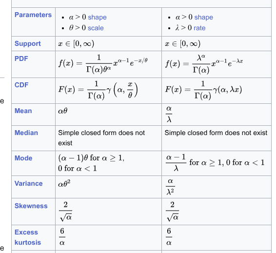
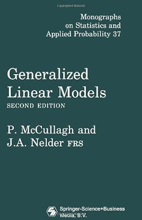
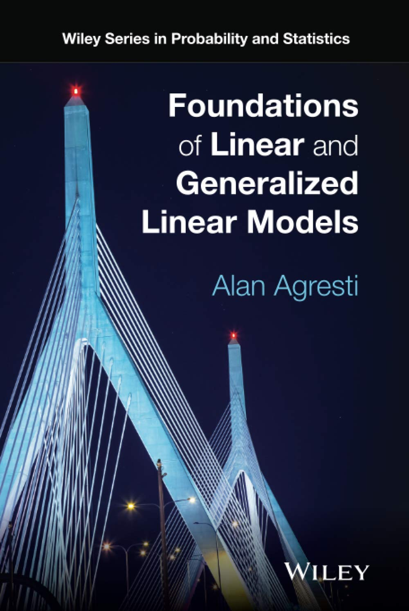
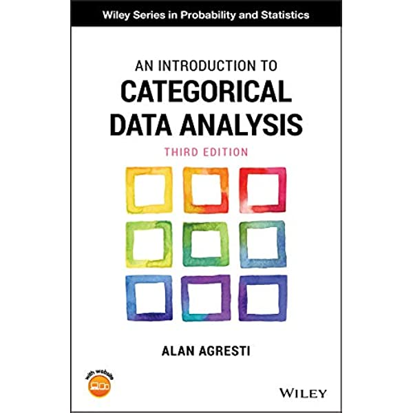
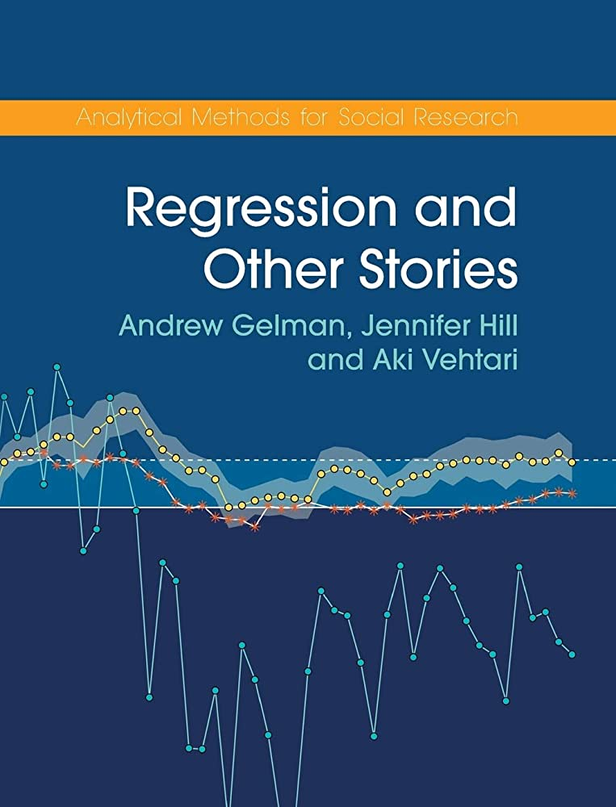
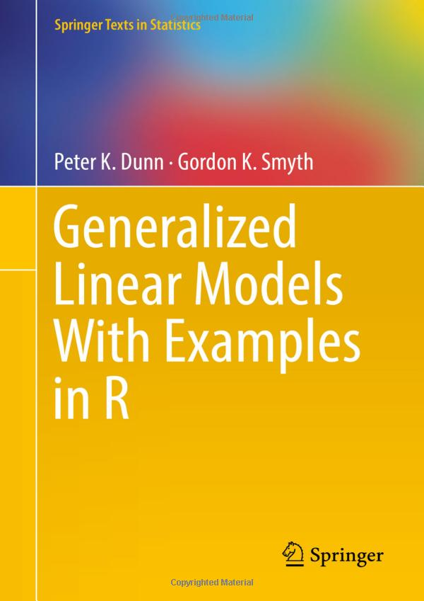
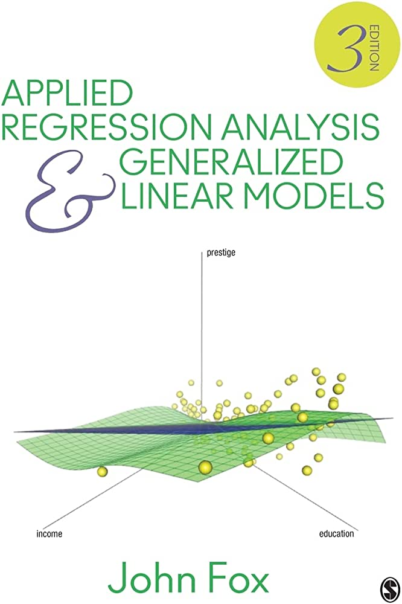
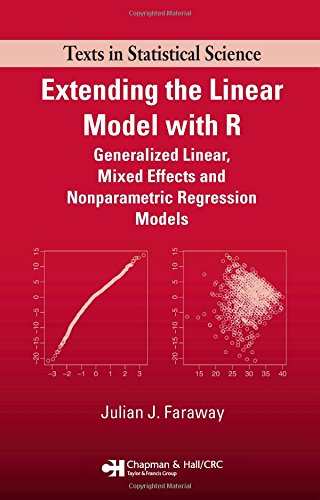



# Beyond the Gaussian distribution {.section}

## Quick recap about Gaussian distribution

- The Gaussian distribution is part of the **Exponential family**
- It is defined with mean ($\mu$) and the standard deviation ($\sigma$)
- It is symmetric (mean, mode and median are the same)
- The support is $[- \infty, + \infty]$

. . .

The Probability Density Function (PDF) is:

$$
f(x, \mu, \sigma) = \frac{1}{\sigma\sqrt{2\pi}} e^{-\frac{1}{2}(\frac{x - \mu}{\sigma})^2}
$$

## Quick recap about Gaussian distribution

```{r, echo = FALSE}
ggnorm(0, 1)
```

## Quick recap about Gaussian distribution

```{r, echo = FALSE}
ggnorm(c(0, 0, 1), c(1, 2, 0.5))
```

\begin{center}
But not always gaussian-like variables!
\end{center}

# Quick recap about the (Gaussian) linear model {.section}

## (Gaussian) Linear Model

I have some [notes](../../notes/misc-lm-glm.qmd) about basic stuff and notation for Linear Models.

```{r}
#| echo: false

x  <- seq(0, 1, 0.2)
lp <- 0.1 + 0.2 * x

dd <- data.frame(
  x    = x,
  mean = lp,
  sd   = 0.02
)

dd$dist <- dist_normal(dd$mean, dd$sd)

dd_points <- data.frame(
  x = runif(100, 0, 1) 
)

dd_points$y <- rnorm(100, 0.1 + 0.2 * dd_points$x, 0.05)

ggplot(dd, aes(x = x, y = mean)) +
  stat_slab(aes(ydist = dist), alpha = 0.5) +
  geom_line() +
  geom_point(aes(y = mean), size = 5, col = "dodgerblue") +
  xlab("x") +
  ylab("y") +
  geom_point(data = dd_points, aes(x = x, y = y), size = 3, alpha = 0.5)
```

## (Generalized) Linear Model, notation

A quick summary about the notation used in the notes:

- $n$ number of observations in the dataset indexed with $i$ ($i = 1, 2, \dots, n$)
- $y_i$ is the observed response for the $i$-th observation while $\mu_i$ is the predicted value from the model (i.e., no errors/residuals)
- $p$ is the number of model coefficients (e.g, $\beta_1, \dots, \beta_p$) while $p' = p + 1$ with 1 being the intercept $\beta_0$ (if included). $\mathop{\boldsymbol{\beta}}\underset{p' \times 1}{}$ is the vector of all coefficients.
- $p'$ is also the number of columns in the model matrix. In other terms the number of predictors (considering that categorical predictors with $k$ levels will create $k - 1$ columns). $\mathop{\mathbf{X}}\underset{n \times p'}{}$ is the model matrix with all predictors
- $x_{p_i}$ is the value of the predictor $x_p$ for the $i$ th observation
- $\mathbf{y}$ is a vector with all the observations. Each element is $y_i$ with $i = 1, 2, \dots, n$

# Understanding distributions {.section}

## Understanding distributions

A probability distribution of a random variable $X$ is the set of probabilities assigned to each possible value $x$.

We can have:

- **discrete random variables**: counts, binary, etc.
- **continuous random variables**: time, weight, etc.

## Variables and constants

As any other function, the probability function has constants and variables:

$$
f(x \mid \boldsymbol{\theta})
$$

Where $x$ is a specific value and $\theta$ is a vector of variables defining a specific function and $f(\cdot)$ is a certain function.

## Variables and constants, an example

For example, the Gaussian distribution is defined as:

$$
f(x \mid \mu, \sigma^2) = \frac{1}{\sqrt{2\pi\sigma^2}} \exp\left( - \frac{(x - \mu)^2}{2\sigma^2} \right)
$$

Here the variables are $\mu$ (the mean) and $\sigma^2$ (the variance) while $\pi$ is a constant.

## Probability mass and density function

An important distinction is about discrete and continuous random variables:

- For discrete random variables $f(X)$ becomes $P(X = x \mid \boldsymbol{\theta})$ because we are assigning a certain probability to a discrete variables. The function is called **probability mass function** (PMF)
- For continuous random variables we stick with $f(X \mid \boldsymbol{\theta})$ and the function is called **probability density function** (PDF)

. . .

The PMF return the probability associated with a certain value of $x$ while the PDF returns the probability density of a certain value of $x$

## Variables and constants, an example (discrete)

In the case of a Poisson random variable:

$$
p(x \mid \lambda) = \frac{\lambda^{x} e^{-\lambda}}{x!}
$$

Where the only variable is $\lambda$.

## Moments of the distributions

When we use the distributions, we are usually interested in some properties describing the distribution. These are called *moments* defined as quantitative measures related to the shape of the function's graph^[https://en.wikipedia.org/wiki/Moment_(mathematics)]. Common moments are:

- **First moment**: is the expected value (i.e., the mean) of the distribution
- **Second moment**: is the variance of the distribution
- **Third moment**: is the skewness
- **Fourth moment**: is the kurtosis

## Moments of the distributions

- Moments are always the same but the way we actual compute them could change according to the distribution. For example, in the case of Gaussian distribution the mean and the variance are the same as the parameters defining the distribution.
- In the Gamma distribution for example, the parameters are the shape $\alpha$ and scale $\theta$ or rate $\lambda$. But the mean is, for example, $\frac{\alpha}{\lambda}$ and the variance is, for example, $\frac{\alpha}{\lambda^2}$

## Suggestions for distributions

The Wikipedia pages of the probability distributions are very clear and complete. For the [Gamma distribution](https://en.wikipedia.org/wiki/Gamma_distribution):

{fig-align="center"}

## Why is important?

In linear and generalized linear models we generally include predictors on the mean (first moment) of the distribution. Knowing how the mean and is computed from the parameters is crucial to understand the model.

. . .

In addition we can note that:

- The Gaussian distribution is a very special and ideal case where $\mu$ and $\sigma^2$ are directly available and they are independent
- Other distributions (e.g., the Gamma) are more complicated due to parameters being used for the mean and the variance (i.e., mean-variance relationship)

## Other useful information

In addition to the PDF/PMF we have also:

- **Cumulative Distribution Function** (CDF) usually defined as $F(x) = P(X \leq x)$. Basically provides the probability of being equal or less compared to a certain $x$ value. In R, this is the `q*` (e.g., `qnorm()`) function.
- **Quantile Function** (QF) is the inverse of the CDF. Usually defined as $Q(p) = F^{-1}(p)$ where $p$ is the cumulative probability of interest. Basically it returns the $x$ value (i.e., the quantile) associated with a certain cumulative probability. In R, this is the `p*` (e.g., `pnorm()`) function.

## Examples in R, Gaussian PDF

With the Gaussian distribution the PDF is computed using `dnorm(x, mean, sd)`:

```{r}
#| code-fold: true
x <- seq(-4, 4, 0.01)
d <- dnorm(x, mean = 0, sd = 1)

data.frame(x, d) |> 
  ggplot(aes(x = x, y = d)) +
  geom_line(lwd = 1, col = "dodgerblue") +
  xlab("x") +
  ylab("Density")
```

## Examples in R, Gaussian CDF and QF

```{r}
#| code-fold: true
cp <- pnorm(x, mean = 0, sd = 1)
qf <- qnorm(cp, mean = 0, sd = 1)

cpp <- data.frame(
  x, cp
) |> 
  ggplot(aes(x = x, y = cp)) +
  geom_line()

qfp <- data.frame(
  x, cp
) |> 
  ggplot(aes(x = cp, y = x)) +
  geom_line()

cpp + qfp
```


## But...

In Psychology, variables do not always satisfy the properties of the Gaussian distribution. For example:

- Reaction times
- Percentages or proportions (e.g., task accuracy)
- Counts
- Likert scales
- ...

## Reaction times

Non-negative and probably skewed data:

```{r, echo = FALSE}
dat <- data.frame(
    x = rgamma(1e5, 9, scale = 0.5)*100
) 

dat |> 
    ggplot(aes(x = x)) +
    geom_histogram(fill = "dodgerblue",
                   color = "black") +
    xlab("Reaction Times (ms)") +
    ylab("Count")
```

## Binary outcomes

A series of binary (i.e., *bernoulli*) trials with two possible outcomes:

```{r, echo = FALSE}
dat <- data.frame(y = c(70, 30), x = c("Passed", "Failed"))

dat |> 
    ggplot(aes(x = x, y = y)) +
    geom_col(color = "black",
             fill = "dodgerblue") +
    ylab("%") +
    ylim(c(0, 100)) +
    theme(axis.title.x = element_blank()) +
    ggtitle("Statistics Final Exam (n = 100)")
```

## Counts

Number of symptoms for a group of patients during the last month:

```{r, echo = FALSE}
dat <- data.frame(x = rpois(1e5, 15))

dat |> 
    ggplot(aes(x = x)) +
    geom_bar(fill = "dodgerblue",
             color = "black") +
    scale_x_continuous(breaks = seq(0, 50, 5)) +
    xlab("Number of new patients during one month") +
    ylab("Count")
```

# Should we use a linear model for these variables? {.question}

## Example 1: passing the exam

Probability of **passing the exam** as a function of **how many hours people study**:

```{r, echo = FALSE}
# y = number of exercises solved in 1 semester
# x = percentage of attended lectures

n <- 50
x <- round(runif(n, 0, 100))
b0 <- 0.01
b1 <- 0.08
y <- rbinom(length(x), 1, plogis(qlogis(b0) + b1*x))

dat <- data.frame(id = 1:n, studyh = x, passed = y)
head(dat, 10)
```

## Example 1: passing the exam

```{r}
#| code-fold: false
#| collapse: true

nrow(dat) # number of participants
sum(dat$passed) # number of people that have passed the exam
nrow(dat) - sum(dat$passed) # number of people that have not passed the exam
mean(dat$passed) # proportion of people that have passed the exam

# study hours and passing the exam

tapply(dat$studyh, dat$passed, mean)
table(dat$passed, cut(dat$studyh, breaks = 4))
tapply(dat$passed, cut(dat$studyh, breaks = 4), mean)
```


## Example 1: passing the exam

Let's plot the data:

```{r, echo = FALSE}
exam_plot <- dat |>
  ggplot(aes(x = studyh, y = passed)) +
  geom_hline(yintercept = c(0, 1), linetype = "dashed", col = "firebrick") +
  geom_point(size = 3,
             alpha = 0.5,
             position = position_jitter(height = 0.03))
exam_plot
```

## Example 1: passing the exam, fitting a linear model

Let's fit a linear model `passing ~ study_hours` using `lm`:

```{r, echo = FALSE}
exam_plot +
    geom_smooth(method = "lm", se = F)
```

. . .

**Do you see something strange?**

## Example 1: passing the exam

A little **spoiler**, the relationship should be probably like this:

```{r, echo = FALSE}
exam_plot +
    stat_smooth(method = "glm", 
                se = FALSE,
                method.args = list(family = binomial))
```

## Example 2: number of correct exercises

Another example, the number of solved exercises in a semester as a function of the number of attended lectures ($N = 100$):

```{r, echo = FALSE}
# y = number of exercises solved in 1 semester
# x = percentage of attended lectures

n <- 100
x <- round(runif(n, 0, 63))
y <- rpois(n, exp(0 + 0.05*x))

dat <- data.frame(id = 1:n, nattended = x, nsolved = y)

head(dat, 10)
```

## Example 2: let's see the distribution

```{r echo = FALSE}
dat |> 
    ggplot(aes(x = nsolved)) +
    geom_bar()
```

## Example 2: fitting a linear model

```{r, echo = FALSE}
exam_plot <- dat |> 
    ggplot(aes(x = nattended, y = nsolved)) +
    geom_hline(yintercept = 0, linetype = "dashed", col = "firebrick") +
    geom_point(size = 3) +
    xlab("Number of attended lectures") +
    ylab("Solved exercises")
exam_plot
```

## Example 2: fitting a linear model

Again, fitting the linear model seems partially appropriate but there are some problems:

```{r, echo = FALSE}
fitp <- glm(nsolved ~ nattended, data = dat, family = poisson())
dat$p <- predict(fitp, type = "response")
dat$lower <- dat$p - sqrt(dat$p)
dat$upper <- dat$p + sqrt(dat$p)

exam_plot +
  geom_smooth(method = "lm", se = FALSE)
```

## Should we use a linear model for these variables?

Again, fitting the linear model seems partially appropriate but there are some problems:

```{r, echo = FALSE}
exam_plot +
  geom_line(data = dat,
            aes(x = nattended, y = lower),
            lty = "dashed") +
  geom_line(data = dat,
            aes(x = nattended, y = upper),
            lty = "dashed")
```

## Should we use a linear model for these variables?

Also the residuals are quite strange:

```{r, echo = FALSE}
fit <- lm(nsolved ~ nattended, data = dat)

dfit <- data.frame(
    fitted = fitted(fit),
    residuals = residuals(fit)
)

qqn <- dfit |> 
    ggplot(aes(sample = residuals)) + 
    stat_qq() + 
    stat_qq_line() +
    xlab("Theoretical Quantiles") +
    ylab("Residuals")

res_fit <- dfit |> 
    ggplot(aes(x = fitted, y = residuals)) +
    geom_point() +
    ylab("Residuals") +
    xlab("Fitted") +
    geom_smooth(se = FALSE, color = "red")
qqn / res_fit
```

## Should we use a linear model for these variables?

Another little spoiler, the model should consider both the support of the `y` variable and the non-linear pattern. Probably something like this:

```{r, echo = FALSE}
exam_plot +
    stat_smooth(method = "glm", 
                se = FALSE,
                method.args = list(family = poisson))
```

## So what?

Both linear models **somehow capture the expected relationship** but there are **serious fitting problems**:

- impossible predictions
- poor fitting for non-linear patterns
- linear regression assumptions not respected

. . .

As a general rule in ~~life~~ statistics:

> All models are wrong, some are useful

## We need a new class of models...

- Taking into account the **specific features of our response variable**
- Use the concepts of linear models as much as possible
- We need a model that **better approximates the (hypothetical) true data generation process**

# Generalized Linear Models  {.section}

## Main references

The first book ever:

```{r, echo = FALSE, out.width="30%"}

```

## Main references

For a detailed introduction about GLMs

Chapters: 1 (intro), 4 (GLM fitting), 5 (GLM for binary data)

```{r, echo = FALSE, out.width="30%"}

```

## Main references

For a basic and well written introduction about GLM, especially the Binomial GLM

Chapters: 3 (intro GLMs), 4-5 (Binomial Logistic Regression)

```{r, echo = FALSE, out.width="50%"}

```

## Main references

Great resource for interpreting Binomial GLM parameters:

Chapters: 13-14 (Binomial Logistic GLM), 15 (Poisson and others GLMs)

```{r, echo = FALSE, out.width="30%"}

```

## Main references

Detailed GLMs book. Very useful especially for the diagnostic part:

Chapters: 8 (intro), 9 (Binomial GLM), 10 (Poisson GLM and overdispersion)

```{r, echo = FALSE, out.width="30%"}

```

## Main references

The holy book :)

Chapters: 14 and 15

```{r, echo = FALSE, out.width="30%"}

```

## Main references

Another good reference...

Chapters: 8

```{r, echo = FALSE, out.width="30%"}

```

## General idea

- using distributions **beyond the Gaussian**
- modeling **non linear functions** on the response scale
- taking into account **mean-variance relationships**

## Recipe for a GLM

- **Random Component**
- **Systematic Component**
- **Link Function**

## Random Component

The **random component** of a GLM identify the response variable $y$ coming from a certain probability distribution.

```{r, echo = FALSE, out.width="50%"}
par(mfrow = c(1,3))

curve(dnorm(x), -4, 4, main = "Normal", ylab = "density(x)", cex.lab = 1.5, cex.main = 1.5)
plot(0:10, dbinom(0:10, 10, 0.5), type = "h", main = "Binomial", ylab = "density(x)",
     cex.lab = 1.5, cex.main = 1.5, xlab = "x")
points(0:10, dbinom(0:10, 10, 0.5), pch = 19)
plot(0:20, dpois(0:20, 8), type = "h", main = "Poisson", ylab = "density(x)",
     cex.lab = 1.5, cex.main = 1.5,
     xlab = "x")
```

## Systematic Component

The **systematic component** or *linear predictor* ($\eta$) of a GLM is:

$$
\eta_i = \beta_0 + \beta_1 x_{i1} + \beta_2 x_{i2} + \cdots + \beta_p x_{ip}
$$

Or in matrix notation:

$$
\boldsymbol{\eta} = \mathbf{X}\boldsymbol{\beta}
$$

Basically it describes how the expected value (i.e., the mean, the first moment) $\mu$ of the chosen distribution (the random component) varies according to the predictors.

::: aside
In the [notes](../../notes/misc-lm-glm.qmd) we make a distinction between $\mu_i$ and $\eta_i$. For the moment we can think as $\eta_i$ being the same as $\mu_i$ but it will be more clear later.
:::


## Link Function

The **link function** $g(\cdot)$ is an **invertible** function linking the expected value (i.e., the mean, the first moment) $\mu$ of the random component with the systematic component $\boldsymbol{\eta} = \mathbf{X}\boldsymbol{\beta}$.

$$
g(\boldsymbol{\mu}) = \boldsymbol{\eta} = \mathbf{X}\boldsymbol{\beta}
$$

The inverse link function $g^{-1}(\cdot)$ maps $\eta$ into the original scale $\mu$.

$$
\boldsymbol{\mu} = g(\boldsymbol{\eta})^{-1} = g(\boldsymbol{\mathbf{X}\boldsymbol{\beta}})^{-1}
$$

## Link function

The simplest **link function** is the **identity link** where $g(\mu) = \mu$ and corresponds to the standard linear model. In fact, the linear regression is just a GLM with a **Gaussian random component** and the **identity** link function.

```{r}
#| echo: false
#| tbl-cap: Main distributions and link functions
fam <- c("gaussian", "gamma", "binomial", "binomial", "poisson")
link <- c("identity", "log", "logit", "probit", "log")
range <- c("$$(-\\infty,+\\infty)$$", "$$(0,+\\infty)$$",
           "$$\\frac{0, 1, ..., n_{i}}{n_{i}}$$",
           "$$\\frac{0, 1, ..., n_{i}}{n_{i}}$$",
           "$$0, 1, 2, ...$$")

linktab <- data.frame(Family = fam, Link = link, Range = range)
linktab$Family <- code(linktab$Family, "markdown")
linktab |> 
  qtab()
```

# Relevant distributions {.section}

## Bernoulli distribution

A single Bernoulli trial is defined as:

$$
f(x, p) = p^x (1 - p)^{1 - x}
$$

Where $p$ is the probability of success and $k$ the two possible results $0$ and $1$. The mean is $p$ and the variance is $p(1 - p)$

## Binomial distribution

The probability of having $k$ success (e.g., 0, 1, 2, etc.), out of $n$ trials with a probability of success $p$ (and failing $q = 1 - p$) is:

$$
f(n, k, p)= \binom{n}{k} p^k(1 - p)^{n - k}
$$

The $np$ is the mean of the binomial distribution and $np(1 - p)$ is the variance. The binomial distribution is just the repetition of $n$ independent Bernoulli trials.

## Bernoulli and Binomial

A classical example for a Bernoulli trial is the coin flip. In R:

```{r}
#| code-fold: false
n <- 1
p <- 0.7
rbinom(1, n, p) # a single bernoulli trial

n <- 10
rbinom(10, 1, p) # n bernoulli trials

rbinom(1, n, p) # binomial version
```

## Binomial

```{r}
#| echo: false
n <- 30
p <- 0.7
dat <- data.frame(k = 0:n)
dat$y <- dbinom(dat$k, n, p)

dat |> 
    ggplot(aes(x = k, y = y)) +
    geom_point() +
    geom_segment(aes(x = k, xend = k, y = 0, yend = y)) +
    ylab("dbinom(x, n, p)") +
    ggtitle(latex2exp::TeX("$n = 30$, $p = 0.7$"))

```

## Binomial in R {.scrollable}

```{r}
#| code-fold: false
#| collapse: true
# generate k (success)
n <- 50 # number of trials
p <- 0.7 # probability of success
rbinom(1, n, p)

# let's do several experiments (e.g., participants)
rbinom(10, n, p)

# calculate the probability density given k successes
n <- 50
k <- 25
p <- 0.5
dbinom(k, n, p)

# calculate the probability of doing 0, 1, 2, up to k successes
n <- 50
k <- 25
p <- 0.5
pbinom(k, n, p)
```

## Binomial GLM

The Bernoulli distributions is used as **random component** when we have a binary dependent variable or the number of successes over the total number of trials:

- Accuracy on a cognitive task
- Patients recovered or not after a treatment
- People passing or not the exam

. . .

The Bernoulli or the Binomial distributions can be used as **random component** when we have a binary dependent variable or the number of successes over the total number of trials.

. . .

When fitting a GLM with the binomial distribution we are including linear predictors on the expected value $\mu$ i.e. the probability of success.

## Binomial GLM

Most of the GLM models deal with a mean-variance relationship:

```{r}
#| fig-width: 10
#| echo: false

p <- seq(0, 1, 0.01)
par(mfrow = c(1,2))
curve(plogis(x), 
      -4, 4, 
      ylab = "Probability", 
      xlab = "x", 
      lwd = 2,
      main = "Logistic Distribution")
plot(p, 
     p * (1 - p), 
     xlim = c(0, 1),
     xlab = latex("\\mu = p"), 
     ylab = latex("V = p(1 - p)"),
     type = "l",
     lwd = 2,
     main = "Mean-Variance Relationship")
```

## Poisson distribution

The number of events $k$ during a fixed time interval (e.g., number of new users on a website in 1 week) is:

\begin{align*}
f(k,\lambda) = Pr(X = k) = \frac{\lambda^k e^{-\lambda}}{k!}
\end{align*}

Where $k$ is the number of occurrences ($k = 0, 1, 2, ...$), $e$ is Euler's number ($e = 2.71828...$) and $!$ is the factorial function. The mean and the variance of the Poisson distribution is $\lambda$.

## Poisson distribution

```{r, echo = FALSE}
lambda <- c(5, 10, 15)
ggpois(lambda, type = "pl")
```

As $\lambda$ increases, the distribution is well approximated by a Gaussian distribution, but the Poisson is discrete.

## Poisson distribution in R

```{r}
#| code-fold: false
#| collapse: false
n <- 1000
x <- rpois(n, lambda = 30)

mean(x)
var(x)
```

We can also use all the other functions such as the `dpois()`, `qpois()` and `ppois()`

## Poisson distribution in R

The mean-variance relationship can be easily seen with a continuous predictor:

```{r}
#| echo: false
#| fig-width: 10
x <- runif(1000)
y <- rpois(1000, exp(log(10) + log(5)*x))

qplot(x, y, type = "p", alpha = 0.5, size = 3)
```

## Gamma distribution

The Gamma distribution has several [:parametrizations](https://en.wikipedia.org/wiki/Gamma_distribution). One of the most common is the **shape-scale** parametrization:

$$
f(x;k,\theta )={\frac {x^{k-1}e^{-x/\theta }}{\theta ^{k}\Gamma (k)}}
$$
Where $\theta$ is the **scale** parameter and $k$ is the **shape** parameter.

## Gamma distribution

```{r}
ggamma(mean = c(10, 20, 30), sd = c(10, 10, 10), show = "ss")
```

## Gamma $\mu$ and $\sigma^2$

The mean and variance are defined as:

- $\mu = k \theta$ and $\sigma^2 = k \theta^2$ with the **shape-scale** parametrization
- $\mu = \frac{\alpha}{\beta}$ and $\frac{\alpha}{\beta^2}$ with the **shape-rate** parametrization

. . .

Another important quantity is the **coefficient of variation** defined as $\frac{\sigma}{\mu}$ or $\frac{1}{\sqrt{k}}$ (or $\frac{1}{\sqrt{\alpha}}$).

The Gamma distribution is quite complex, I have some [notes](https://filippogambarota.github.io/notes/understanding-gamma/https://filippogambarota.github.io/notes/understanding-gamma/) with more insigths about the parametrization.

## Gamma distribution

Again, we can see the mean-variance relationship:

```{r}
ggamma(shape = c(5, 5), scale = c(10, 20), show = "ss")
```


## Gamma parametrization {.scrollable}

To convert between different parametrizations, you can use the `gamma_params()` function:

```{r}
#| output: asis
#| echo: false

filor::print_fun(funs$gamma_params)
```

## Gamma parametrization

```{r}
#| code-fold: false
gm <- gamma_params(mean = 30, sd = 10)
unlist(gm)

y <- rgamma(1000, shape = gm$shape, scale = gm$scale)
```

## Gamma parametrization

```{r}
#| echo: false
hist(y, main = latex("$\\mu = %.3f$, $\\sigma = %.3f$", mean(y), sd(y)))
```

## GLM in R

Is not always easy to work with link functions. In R we can use the `distribution(link = )` function to have several useful information. For example:

```{r}
#| eval: false
#| code-fold: false
fam <- binomial(link = "logit")
fam$linkfun() # link function, from probability to eta
fam$linkinv() # inverse of the link function, from eta to probability
```

We are going to see the specific arguments, but this tricks works for any family and links, even if you do not remember the specific function or formula.

## Intutive way of writing models

@Dunn2018-ww uses a nice way of presenting models that could be useful. Basically He specifies the random component distribution and then he specified the parameter(s) where we are including the systematic component.

For example, a Generalized Linear Model with the Gaussian family and identity link could be written as:

$$
\begin{aligned}
y_i &\sim \mathrm{N}(\mu_i, \sigma^2) \quad && \text{Random component} \\
\mu_i &= g^{-1}(\eta_i) \quad && \text{Inverse link} \\
\eta_i &= g(\beta_0 + \beta_1 x_{1i} + \beta_2x_{2i}) \quad && \text{Systematic component, link} \\
\end{aligned}
$$

The $i$ subscript indicates that that element varies for each observation $i$ according to the linear predictor $\eta_i$ after taking the inverse of the link function.

## Assumptions

- **Lack of outliers**: All responses were generated from the same process, so that the same model is appropriate for all the observations.
- **Link function**: The correct link function $g(\cdot)$ is used.
- **Linearity**: All important explanatory variables are included, and each explanatory variable is included in the linear predictor on the correct scale.^[This is not linearity of predictors but of coefficients. $x^2$ is allowed and $\beta_1^2$ not]
- **Variance function**: The correct variance function $\mbxo{var}(\mu)$ is used. This is the mean-variance relationship
- **Dispersion parameter**: The dispersion parameter is constant. This is a subtle but important distinction. The variance is not constant in GLMs but the dispersion parameter is. In Gaussian linear models the disperions is the same as the variance.
- **Independence**: The responses $y_i$ are independent of each other. This is something related to the data collection and data structure
- **Distribution**: The responses $y_i$ come from the specified distribution.

::: aside
From @Dunn2018-ww [pp. 297-298]
:::

## References {.refs}

