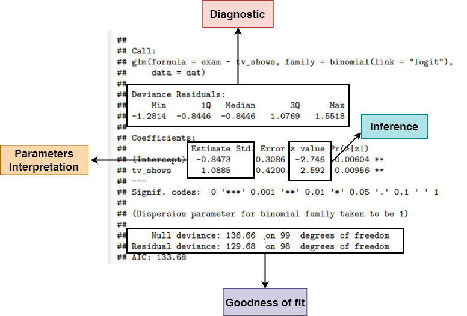



## Example: Passing the exam

We want to measure the impact of **watching tv-shows** on the probability of **passing the statistics exam**.

- `exam`: **passing the exam** (1 = "passed", 0 = "failed")
- `tv_shows`: **watching tv-shows regularly** (1 = "yes", 0 = "no")

. . .

```{r}
#| echo: false

exam <- sim_dataset("tv_shows", 100, seed = 2025)
#fit <- glm(exam ~ tv_shows, data = dat, family = binomial(link = "logit"))
```

```{r}
#| echo: false
filor::trim_df(exam) |>
    qtab()
```

## Example: Passing the exam

We can create the **contingency table**

```{r}
xtabs(~passed + tv_shows, data = exam) |> 
    addmargins()
```

## Example: Passing the exam

Each cell probability $p_{ij}$ is computed as $p_{ij}/n$

```{r}
(xtabs(~passed + tv_shows, data = exam)/nrow(exam)) |> 
    addmargins()
```

## Example: Passing the exam - Odds

The most common way to analyze a 2x2 contingency table is using the **odds ratio** (OR). Firsly let's define *the odds of success* as:

$$
\begin{align*}
odds = \frac{p}{1 - p} \\
p = \frac{odds}{odds + 1}
\end{align*}
$$

- the **odds** are non-negative, ranging between 0 and $+\infty$
- an **odds** of e.g. 3 means that we expect 3 *success* for each *failure*

## Example: Passing the exam - Odds

For the `exam` example:

```{r}
# odds <- function(p) p / (1 - p)
p11 <- mean(with(exam, passed[tv_shows == 1])) # passing exam | tv_shows
p11
odds(p11)
```

## Example: Passing the exam - Odds Ratio

The OR is a ratio of odds:

$$
OR = \frac{\frac{p_1}{1 - p_1}}{\frac{p_2}{1 - p_2}}
$$

- OR ranges between 0 and $+\infty$. When $OR = 1$ the odds for the two conditions are equal
- An e.g. $OR = 3$ means that being in the condition at the numerator increase 3 times the odds of success

## Example: Passing the exam - Odds Ratio

```{r}
# or <- function(p1, p2) odds(p1) / odds(p2)
p11 <- mean(with(exam, passed[tv_shows == 1])) # passing exam | tv_shows
p10 <- mean(with(exam, passed[tv_shows == 0])) # passing exam | not tv_shows
p11
p10
or(p11, p10)
```

## Why using these measure?

The odds have an interesting property when taking the logarithm. We can express a probability $p$ using a scale ranging $[-\infty, +\infty]$

```{r, echo = FALSE}
p1 <- seq(0, 1, 0.001)
p2 <- seq(1, 0, -0.001)

ord <- data.frame(
    p1, p2
)

ord$or <- or(ord$p1, ord$p2)

ord |> 
    ggplot(aes(x = p1, y = log(or))) +
    geom_hline(yintercept = 0, 
               linetype = "dashed",
               col = "firebrick2",
               linewidth = 0.5) +
    geom_line(linewidth = 1) +
    ylab(latex2exp::TeX("$log(\\frac{p}{1 - p})$")) +
    scale_x_continuous(
        latex2exp::TeX("$p$"),
        sec.axis = dup_axis(
            trans = .~rev(.),
            name = latex2exp::TeX("$1 - p$")
        )
    )
```

## Another example, **Teddy Child**

We considered a Study conducted by the University of Padua (TEDDY Child
Study, 2020)^[Thanks to Prof. Paolo Girardi for the example, see https://teddychild.dpss.psy.unipd.it/ for information]. About post-partum depression. You can access the data using `data("teddy")` or within the `data/` folder.

```{r, echo = FALSE}
data("teddy")

teddy |> 
    head() |> 
    qtab()
```

## Another example, **Teddy Child**

We want to see if the parental stress increase the probability of having post-partum depression:

```{r, echo = FALSE}
teddy |> 
    ggplot(aes(x = Depression_pp, 
               y = Parental_stress,
               fill = Depression_pp)) +
    geom_boxplot(outlier.colour = NA,
                 show.legend = FALSE) +
    geom_point(position = position_jitter(width = 0.2),
               show.legend = FALSE)
```

## Another example, **Teddy Child**

```{r, echo = FALSE}
teddy$Depression_pp01 <- ifelse(teddy$Depression_pp == "Yes", 1, 0) 

teddy_plot <- teddy |> 
    ggplot(aes(x = Parental_stress, y = Depression_pp01)) +
    geom_point(position = position_jitter(height = 0.02),
               alpha = 0.5) +
    ylab("Post-partum Depression") +
    xlab("Parental Stress")
teddy_plot
```

## Another example, **Teddy Child**

Let's start by fitting a linear model `Depression_pp ~ Parental_stress`. We consider "Yes" as 1 and "No" as 0.

```{r}
fit_teddy_lm <- lm(Depression_pp01 ~ Parental_stress, data = teddy)
summary(fit_teddy_lm)
```

## Another example, **Teddy Child**

Let's add the fitted line to our plot:

```{r, echo = FALSE}
teddy_plot +
    stat_smooth(method = "lm", se = FALSE)
```

## Another example, **Teddy Child**

... and check the residuals, pretty bad right?

```{r, echo = FALSE}
#| fig-width: 10
par(mfrow = c(2,2))
plot(fit_teddy_lm)
```

## Another example, **Teddy Child**

As for the exam example, we could compute a sort of contingency table despite the `Parental_stress` is a numerical variable by creating some discrete categories (just for exploratory analysis):

```{r, echo = FALSE}
teddy <- teddy |> 
    mutate(Parental_stress_c = case_when(
        Parental_stress < 40 ~ "< 40",
        Parental_stress >= 40 & Parental_stress < 60 ~ "40-60",
        Parental_stress >= 60 & Parental_stress < 80 ~ "60-80",
        Parental_stress >= 80 & Parental_stress < 100 ~ "80-100",
        Parental_stress >= 100 ~ "> 100",
    ))

teddy$Parental_stress_c <- factor(teddy$Parental_stress_c,
                                  levels = c("< 40", "40-60", "60-80", "80-100", "> 100"))
```

```{r}
table(teddy$Depression_pp, teddy$Parental_stress_c) |> 
    round(2)
```


```{r}
table(teddy$Depression_pp, teddy$Parental_stress_c) |> 
    prop.table(margin = 2) |> 
    round(2)
```

## Another example, **Teddy Child**

Ideally, we could compute the increase in the odds of having the post-partum depression as the parental stress increase. In fact, as we are going to see, the Binomial GLM is able to estimate the non-linear increase in the probability.

```{r, echo = FALSE}
teddy_plot +
    stat_smooth(method = "lm", se = FALSE,
                aes(color = "LM")) +
    stat_smooth(method = "glm", se = FALSE, method.args = list(family = binomial),
                aes(color = "GLM")) +
    theme(legend.title = element_blank(),
          legend.position = "bottom")
```

## Binomial GLM

$$
\begin{aligned}
y_i m_i &\sim \mathrm{Binomial}(\mu_i, m_i) \quad && \text{Random component} \\
\mbox{log} \frac{\mu_i}{1 - \mu_i} &= \beta_0 + \beta_1 x_{1i} + \dots + \beta_{p'} x_{p'i} \quad && \text{Systematic component}
\end{aligned}
$$

If you see the details about the [Binomial distribution](https://en.wikipedia.org/wiki/Binomial_distribution), $\mu = pm$ where $p$ is the probabiluty of success and $m$ the number of trials. When $m = 1$ we have the special case of a Bernoulli distribution. In this case we have $n$ ($n$ is the sample size) independent Bernoulli distributions.

## Binomial GLM

- The **random component** of a Binomial GLM the binomial distribution with parameter $p$
- The **systematic component** is a linear combination of predictors and coefficients $\boldsymbol{\beta X}$
- The **link function** is a function that map probabilities into the $[-\infty, +\infty]$ range.

## Logit Link

The **logit** link is the most common link function when using a binomial GLM:

$$
log \left(\frac{p_i}{1 - p_i}\right) = \beta_0 + \beta_1x_{i1} + \beta_2x_{i2} + \cdots + \beta_px_{ip}
$$

The inverse of the **logit** maps again the probability into the $[0, 1]$ range:

$$
p = \frac{e^{\beta_0 + \beta_1x_{i1} + \beta_2x_{i2} + \cdots + \beta_px_{ip}}}{1 + e^{\beta_0 + \beta_1x_{i1} + \beta_2x_{i2} + \cdots + \beta_px_{ip}}}
$$

## Logit Link

Thus with a single numerical predictor $x$ the relationship between $x$ and $p$ in non-linear on the probability scale but linear on the logit scale.

```{r, echo = FALSE}
x <- seq(0, 1, 0.001)
p <- plogis(qlogis(0.01) + 8*x)

dat <- data.frame(x, p)
dat$lp <- log(odds(dat$p))

dat |> 
    pivot_longer(c(p, lp)) |> 
    mutate(name = factor(name, 
                         labels = c(latex2exp::TeX("$log(\\frac{p}{1-p})$"),
                                    latex2exp::TeX("$p$")))) |> 
    ggplot(aes(x = x*100, y = value)) +
    facet_wrap(~name, scales = "free",
               labeller = label_parsed) +
    geom_line() +
    xlab(latex2exp::TeX("$X_1$")) +
    theme(axis.title.y = element_blank())
```

## Logit Link

The main problem when using the logit link (and any link function beyond the *identity*) is that effects are linear on the link function scale but non-linear on the response scale.

```{r, echo = FALSE}
x <- runif(10000, 0, 1)
p <- plogis(qlogis(0.01) + 8*x)
linpred <- qlogis(p)
y <- rbinom(length(x), 1, p)

dat <- data.frame(
    y = y,
    x = x,
    p = p,
    lp = linpred
)

fp <- function(x) {
    qlogis(0.01) + 8 * x
}

pp <- c(0.5, 0.6, 0.7, 0.8)

plot_logit <- ggplot() +
    stat_function(data = data.frame(x = c(0,1)), 
                  aes(x),
                  fun = fp) +
    # points
    geom_point(aes(x = pp, y = fp(pp))) +
    geom_point(aes(x = c(0, 0, 0, 0), y = fp(pp))) + 
    geom_point(aes(x = pp, y = c(-5, -5, -5, -5))) +
    # segments
    geom_segment(aes(x = pp, y = c(-5, -5, -5, -5),
                     xend = pp, yend = fp(pp)),
                 linetype = "dashed",
                 linewidth = 0.3) +
    geom_segment(aes(x = pp, y = c(-5, -5, -5, -5),
                     xend = pp, yend = fp(pp)),
                 linetype = "dashed",
                 linewidth = 0.3) +
    geom_segment(aes(x = c(0,0,0,0), y = fp(pp),
                     xend = pp, yend = fp(pp)),
                 linetype = "dashed",
                 linewidth = 0.3) +
    xlab(latex2exp::TeX("$X_1$")) +
    ylab(latex2exp::TeX("$logit(p)$")) +
    theme(aspect.ratio=1)

plot_invlogit <- ggplot() +
    stat_function(data = data.frame(x = c(0,1)), 
                  aes(x),
                  fun = function(x) plogis(fp(x))) +
    # points
    geom_point(aes(x = pp, y = plogis(fp(pp)))) +
    geom_point(aes(x = pp, y = c(0, 0, 0, 0))) +
    geom_point(aes(x = c(0, 0, 0, 0), y = plogis(fp(pp)))) +
    # segments
    geom_segment(aes(x = pp, y = c(0, 0, 0, 0),
                     xend = pp, yend = plogis(fp(pp))),
                 linetype = "dashed",
                 linewidth = 0.3) +
    geom_segment(aes(x = pp, y = c(0, 0, 0, 0),
                     xend = pp, yend = plogis(fp(pp))),
                 linetype = "dashed",
                 linewidth = 0.3) +
    geom_segment(aes(x = c(0, 0, 0, 0), y = plogis(fp(pp)),
                     xend = pp, yend = plogis(fp(pp))),
                 linetype = "dashed",
                 linewidth = 0.3) +
    theme(aspect.ratio=1) +
    xlab(latex2exp::TeX("$X_1$")) +
    ylab(latex2exp::TeX("$logit^{-1}(p)$"))

plot_logit | plot_invlogit
```

## Model fitting in R

```{r, echo = FALSE}

```

## The big picture...

```{r, echo = FALSE}

```


## Model fitting in R

We can model the contingency table presented before. We put data in **binary form**:

::: columns
:::: column

```{r, echo = FALSE}
# binomial data
exam |> 
    xtabs(~passed + tv_shows, data = _)
```

::::

:::: column

```{r, echo = FALSE}
# binary data
exam |> 
    filor::trim_df()
```

::::
:::

## Intercept only model

Let's start from the simplest model (often called null model) where there are no predictors:

```{r}
fit0_exam <- glm(passed ~ 1, data = exam, family = binomial(link = "logit"))
summary(fit0_exam)
```

## Intercept only model

When fitting an intercept-only model, the parameter is the average value of the `y` variable:

$$
\begin{align*}
\log(\frac{p}{1 - p}) = \beta_0 \\
p = \frac{e^{\beta_0}}{1 + e^{\beta_0}}
\end{align*}
$$

## Intercept only model

In R, the $logit(p)$ is computed using `qlogis()` that is the `q` + `logis` combination of functions to work with probability distributions. The $logit^{-1}$ thus the inverse of the logit function is `plogis()`:

```{r}
# average y on the respo nse scale
mean(exam$passed)

c("logit" = coef(fit0_exam)[1],
  "inv-logit" = plogis(coef(fit0_exam)[1])
)
```

## Link function (TIPS)

If you are not sure about how to transform using the link function you can directly access the `family()` object in R that contains the appropriate link function and the corresponding inverse.

```{r, eval=FALSE}
bin <- binomial(link = "logit")
bin$linkfun() # the same as qlogis
bin$linkinv() # the same as plogis
```

## Model with $X$

Now we can add the `tv_shows` predictor. Now the model has two coefficients. Given that the `tv_shows` is a binary variable, the intercept is the average `y` when `tv_shows` is 0, and the `tv_shows` coefficient is the increase in `y` for a unit increase in `tv_shows`:

```{r}
fit_exam <- glm(passed ~ tv_shows, data = exam, family = binomial(link = "logit"))
summary(fit_exam)
```

## Model with $X$

Thinking about our data, the `(Intercept)` is the probability of passing the exam without watching tv-shows. The `tv_shows` (should be) the difference in the probability of passing the exam between people who watched or did not watched tv-shows, BUT:

- we are on the logit scale. Thus we are modelling **log(odds)** and not probabilities
- a difference on the **log** scale is a ratio on the raw scale. Thus taking the exponential of `tv_shows` we obtain the ratio of odds of passing the exam watching vs non-watching tv-shows. Do you remember something?

## Model with $X$

The `tv_shows` is exactly the Odds Ratio that we calculated on the contingency table:

```{r}
# from model coefficients
exp(coef(fit_exam)["tv_shows1"])

# from the contingency table
or(mean(exam$passed[exam$tv_shows == 1]),
   mean(exam$passed[exam$tv_shows == 0]))
```

## Binomial vs Binary

There are several practical differences between binomial and binary models:

- data structure
- fitting function in R
- residuals and residual deviance
- type of predictors 

## Binomial vs Binary data structure

The most basic Binomial regression is a vector of binary $y$ values and a continuous or categorical predictor. Let's see a common data structure in this case:

```{r}
#| code-fold: true
n <- 30
df <- data.frame(id = 1:n)
df$x <- sim_n_x(df, list(level = "obs", f = runif))
b0 <- qlogis(0.01)
b1 <- 8

df |> 
    sim_data(~x, c(b0, b1), family = binomial(), which.mu = "prob", rng.arg = list(size = 1)) |> 
    select(id, x, y) |> 
    filor::trim_df(n = 4)
```

## Binomial vs Binary data structure

Or equivalently with a categorical variable:

```{r}
#| code-fold: true

n <- 15
x <- c("a", "b")
df <- sim_design(n, between = list(x = x))
b0 <- qlogis(0.4)
b1 <- log(or(0.7, 0.4))

df |> 
    sim_data(formula = ~x, beta = c(b0, b1), which.mu = "prob", family = binomial(), rng.arg = list(size = 1)) |> 
    dplyr::select(id, x, y) |> 
    filor::trim_df(4)
```

## Binomial vs Binary data structure

When using a Binomial data structure we count the number of success for each level of $x$. `nc` is the number of 1 responses, `nf` is the number of 0 response out of `nt` trials:

```{r}
#| code-fold: true
x <- seq(0, 1, 0.05)
nt <- 10
nc <- rbinom(length(x), nt, plogis(qlogis(0.01) + 8*x))
dat <- data.frame(x, nc, nf = nt - nc,  nt)

dat |> 
    filor::trim_df(4)
```

## Binomial vs Binary data structure

With a categorical variable we have essentially a contingency table:

```{r}
#| code-fold: true
x <- c("a", "b")
nt <- 10
nc <- rbinom(length(x), nt, plogis(qlogis(0.4) + log(or(0.7, 0.4))*ifelse(x == "a", 1, 0)))

datc <- data.frame(x, nc, nf = nt - nc,  nt)
datc
```

## Binomial vs Binary: data structure

Clearly, expanding or aggregating data is the way to convert a binary into a binomial data structure and the opposite:

```{r}
# from binomial to binary
bin2binary(datc, nc, nt) |> 
    select(y, x) |> 
    filor::trim_df()
```

## Binomial vs Binary: data structure

```{r}
# from binary to binomial
bin2binary(datc, nc, nt)  |>
    binary2bin(y ~ x)
```

## Binomial vs Binary: multilevel disclaimer

- Clearly, in the previous examples, each row correspond to a single observation (in the binary model) or a condition (in the binomial model). Furthermore each row/observation/participants is assumed to be independent.
- If participants performed multiple trials for each condition, we can still use a binomial or binary model BUT we need to take into account the multilevel structure.
- In practice, we need to use a mixed-effects GLM, for example with the `lme4::glmer()` package specifying the appropriate random structure.

## Binomial vs Binary: - fitting function in R

There is a single way to implement a binary model in R and two ways for the binomial version:

```{r, eval = FALSE}
# binary regression
glm(y ~ x, family = binomial(link = "logit"))

# binomial with cbind syntax, nc = number of 1s, nf = number of 0s, nc + nf = nt
glm(cbind(nc, nf) ~ x, family = binomial(link = "logit"))

# binomial with proportions and weights, equivalent to the cbind approach, nt is the total trials
glm(nc/nt ~ x, weights = nt, binomial(link = "logit"))
```

## Binomial vs Binary: residuals and residual deviance

A more relevant difference is about the residual analysis. The binary regression has different residuals compared to the binomial model fitted on the same dataset^[To note, the **binned residuals** could be considered as an attempt to mitigate the binary residuals problem by creating bins of fitted/residual values similarly to fitting a binomial model.].

```{r, echo=FALSE}
x <- seq(0, 1, 0.05)
nt <- 10
nc <- rbinom(length(x), nt, plogis(qlogis(0.01) + 8*x))
dat_binomial <- data.frame(x, nc, nf = nt - nc,  nt)
dat_binary <- bin2binary(dat_binomial, nc, nt)
```

```{r}
fit_binomial <- glm(nc/nt ~ x, weights = nt, data = dat_binomial, family = binomial(link = "logit"))
fit_binary <- glm(y ~ x, data = dat_binary, family = binomial(link = "logit"))
```

## Binomial vs Binary: residuals and residual deviance

```{r, echo = FALSE}
par(mfrow = c(1,2))

plot(fitted(fit_binomial), rstandard(fit_binomial, type = "deviance"),
     xlab = "Fitted", ylab = c("Std. Deviance Residuals"),
     pch = 19,
     lwd = 5,
     cex.lab = 1.2,
     cex.axis = 1.2,
     cex.main = 1.5,
     main = "Binomial Model")

plot(fitted(fit_binary), rstandard(fit_binary, type = "deviance"),
     xlab = "Fitted", ylab = c("Std. Deviance Residuals"),
     pch = 19,
     lwd = 5,
     cex.lab = 1.2,
     cex.axis = 1.2,
     cex.main = 1.5,
     main = "Binary Model")
```

## Binomial vs Binary: residuals and residual deviance

The residual deviance is also different. In fact, there is more residual deviance on the binary compared to the binomial model. However, comparing two binary and binomial models actually leads to the same conclusion. In other terms the deviance seems to be on a different scale^[Thanks to Prof. Altoè for this suggestion]:

```{r}
fit0_binary <- update(fit_binary, . ~ -x) # null binary model
fit0_binomial <- update(fit_binomial, . ~ -x) # null binary model
```

## Binomial vs Binary: residuals and residual deviance

In fact, if we compare the full model with the null model in both binary and binomial version, the LRT is the same but the deviance is on a different scale. Comparing a binary with a binomial model could be completely misleading.

```{r}
#| collapse: true
anova(fit_binomial, fit0_binomial, test = "Chisq")
anova(fit_binary, fit0_binary, test = "Chisq")
```

## Binomial vs Binary: type of predictors 

This point is less relevant in this course but important in general. Usually, **binary regression** is used when the predictor is at the *trial level* whereas **binomial regression** is used when the predictor is at the *participant level*. When both levels are of interests one should use a mixed-effects model where both levels can be modeled.

- the probability of correct responses during an exam as a function of the question difficulty (each trial/row could have a different $x$ level)
- the probability of passing the exam as a function of the high-school background regardless of having multiple trials, each trial/row has the same $x_i$ for the participant $i$

## Binomial vs Binary: type of predictors 

> The probability of correct responses during an exam as a function of the question difficulty

- each question (i.e., *trial*) has a 0/1 response and a difficulty level
- we are modelling a single participant, otherwise we need a multilevel (mixed-effects) model

## Binomial vs Binary: type of predictors 

```{r}
#| code-fold: true
dat <- expand_grid(id = 1, question = 1:30)
dat$y <- rbinom(nrow(dat), 1, 0.7)
dat$difficulty <- sample(1:5, nrow(dat), replace = TRUE)

dat |> 
    select(id, question, difficulty, y) |> 
    filor::trim_df()
```

## Binomial vs Binary: type of predictors 

> the probability of passing the exam as a function of the high-school background

- each "background" has different students that passed or not the exam (0/1)

## Binomial vs Binary: type of predictors 

```{r, echo = FALSE}
dat <- data.frame(background = c("math", "chemistry", "art", "sport"))
nt <- c(30, 20, 10, 20)
dat$nc <- rbinom(nrow(dat), nt, 0.7)
dat$nf <- nt - dat$nc
dat$nt <- nt

dat |> 
    filor::trim_df() 
```

Or the binary version:

```{r, echo = FALSE}
dat |> 
    bin2binary(nc, nt) |>
    filor::trim_df()
```

## Binomial vs Binary: type of predictors 

- To note that despite we can convert between the binary/binomial, the two models are not always the same. The *high-school background example* can be easily modelled either with a binary or binomial model because the predictor is at the participant level that coincides with the trial level.
- On the other side, the *question difficulty example* can only be modelled using a binary regression because each trial (0/1) has a different value for the predictor
- To include both predictors or to model multiple participants on the *question difficulty example* we need a mixed-effects model where both levels together with the repeated-measures can be handled.
- a very clear overview of this topic can be found here [https://www.rensvandeschoot.com/tutorials/generalised-linear-models-with-glm-and-lme4/](https://www.rensvandeschoot.com/tutorials/generalised-linear-models-with-glm-and-lme4/)

# Probit link {.section}

## Probit link

- The mostly used *link function* when using a binomial GLM is the **logit link**. The **probit** link is another *link function* that can be used. The overall approach is the same between **logit** and **probit** models. The only difference is the parameter interpretation (i.e., no odds ratios) and the specific link function (and the inverse) to use.
- The **probit** model use the **cumulative normal distribution** but the actual difference with a **logit** functions is neglegible.

## Probit link

```{r, echo=FALSE}
ggplot() +
    stat_function(aes(color = "Probit"),
                      fun = pnorm) +
    stat_function(aes(color = "Logit"),
                  fun = plogis) +
    xlim(-4, 4) +
    theme(legend.title = element_blank(),
          legend.position = c(0.9,0.2),
          axis.title.x = element_blank()) +
    ylab("Probability")
```

## Probit link {.scrollable}

When using the **probit link** the parameters are interpreted as difference in *z-scores* associated with a unit increase in the predictors. In fact probabilities are mapped into *z-scores* using the cumulative normal distribution.

```{r}
p1 <- 0.7
p2 <- 0.5

qlogis(c(p1, p2)) # log(odds(p1)), logit link
qnorm(c(p1, p2)) # probit link

log(or(p1, p2)) # ~ beta1, logit link
qnorm(p1) - qnorm(p2) # ~beta1, probit link
```

## Probit link

```{r, echo = FALSE}
probit_cum <- ggplot() +
    stat_function(fun = pnorm) +
    xlim(-4, 4) +
    theme(legend.title = element_blank(),
          legend.position = c(0.9,0.2)) +
    ylab(latex2exp::TeX("$p = \\Phi^{-1}(z)$")) +
    xlab("z") +
    geom_segment(aes(x = qnorm(c(p1,p2)),
                     y = c(0, 0),
                     xend = qnorm(c(p1,p2)),
                     yend = c(p1, p2))) +
    geom_segment(aes(x = qnorm(c(p1,p2)),
                     y = c(p1,p2),
                     xend = c(-4, -4),
                     yend = c(p1,p2))) +
    geom_point(aes(x = qnorm(c(p1,p2)),
                   y = c(p1, p2)),
               color = c("red", "blue"),
               size = 5) +
    geom_point(aes(x = qnorm(c(p1,p2)),
                   y = c(0, 0)),
               color = c("red", "blue"),
               size = 5) +
    geom_point(aes(x = c(-4, -4)),
               y = c(p1, p2),
               color = c("red", "blue"),
               size = 5) +
    theme(aspect.ratio = 1)

probit_denp1 <- ggplot() +
    stat_function(fun = dnorm) +
    xlim(-4, 4) +
    ylab("Density") +
    geom_point(aes(x = qnorm(p1),
                   y = c(0)),
               color = c("red"),
               size = 5) +
    geom_point(aes(x = qnorm(p1),
                   y = dnorm(qnorm(p1))),
               color = c("red"),
               size = 5) +
    geom_area(aes(x = c(-4, 4)),
              stat = "function", 
              fun = dnorm,
              fill = "red",
              xlim = c(-4, qnorm(p1)),
              alpha = 0.5) +
    xlab(latex2exp::TeX("$\\Phi(p)$"))

probit_denp2 <- ggplot() +
    stat_function(fun = dnorm) +
    xlim(-4, 4) +
    ylab("Density") +
    geom_point(aes(x = qnorm(p2),
                   y = c(0)),
               color = c("blue"),
               size = 5) +
    geom_point(aes(x = qnorm(p2),
                   y = dnorm(qnorm(p2))),
               color = c("blue"),
               size = 5) +
    geom_area(aes(x = c(-4, 4)),
              stat = "function", 
              fun = dnorm,
              fill = "blue",
              xlim = c(-4, qnorm(p2)),
              alpha = 0.5) +
    xlab(latex2exp::TeX("$\\Phi(p)$"))

right_plot <- cowplot::plot_grid(
    probit_denp1 + theme_minimal(base_size = 15), 
    probit_denp2 + theme_minimal(base_size = 15),
    nrow = 2
)

left_plot <- probit_cum

cowplot::plot_grid(
    left_plot + theme_minimal(base_size = 15), 
    right_plot,
    rel_widths = c(2,1)
)
```

# Parameter Intepretation {.section}

## Model Intepretation

Parameters and effects interpretation is probably the hardest part of GLMs. The main reason is the non linearity of response vs the linearity of the link function. We have few options:

- intepreting model coefficients directly or after transforming to known values (e.g., odds ratios)
- intepreting predictions on the response scale
- marginal effects

## Intepreting model coefficients

Models coefficients are interpreted in the same way as standard regression models. The big difference concerns:

- numerical predictors
- categorical predictors

. . .

Using **contrast coding** and **centering/standardizing** we can make model coefficients easier to intepret.

## Categorical predictors

We use a categorical predictor with $k$ levels, the model will estimate $k - 1$ parameters. The interpretation of these parameters depends on the contrast coding. In R the default is the treatment coding (or dummy coding). We can see the coding scheme using the `model.matrix()` function that return the $\mathbf{X}$ matrix:

```{r, echo = FALSE}
X <- model.matrix(~ tv_shows, data = exam)
rbind(
    head(X),
    tail(X)
)
```

## Categorical predictors

For the `exam` dataset, $\beta_0$ is the reference level (default to 0 because is the first) and $\beta_1$ is the difference between the second level and the reference level. Using, for example, the sum-to-zero coding we can change the $\beta_0$ intepretation.

```{r}
exam$tv_shows0 <- ifelse(exam$tv_shows == 0, -0.5, 0.5)
fit <- glm(passed ~ tv_shows0, data = exam, family = binomial(link = "logit"))
```

## Categorical predictors

```{r}
# grand mean
mean(c(mean(exam$passed[exam$tv_shows == 1]), mean(exam$passed[exam$tv_shows == 0])))

# intercept
plogis(coef(fit)[1])
```

## Categorical predictors

```{r}
#| echo: false
#| fig-width: 10
fit <- glm(passed ~ tv_shows, data = exam, family = binomial(link = "logit"))

dat_coding <- exam |>
    select(tv_shows) |> 
    distinct() |> 
    add_predict(fit, type = "response") |> 
    mutate(gm = mean(pr))

dat_coding$tv_shows <- as.numeric(as.character(dat_coding$tv_shows))
dat_coding$tv_shows0 <- ifelse(dat_coding$tv_shows == 1, 0.5, -0.5)
    
dummy <- dat_coding |> 
    ggplot(aes(x = tv_shows, y = pr)) +
    geom_hline(aes(yintercept = pr, color = factor(tv_shows)),
               linetype = "dashed", show.legend = FALSE) +
    geom_point(size = 5) +
    geom_line() +
    geom_point(x = -Inf, y = dat_coding$pr[2],
               size = 5, col = "red") +
    # ylim(c(0.2, 0.6)) +
    # xlim(c(-0.5, 1.5)) +
    ylab("Probability") +
    xlab("Tv-Shows") +
    scale_color_manual(values = c("red", "black")) +
    annotate("text", dat_coding$tv_shows[1], y = 0.25, label = "Yes", size = 6) +
    annotate("text", dat_coding$tv_shows[2], y = 0.25, label = "No", size = 6) +
    annotate("label", x = -0.4, y = dat_coding$pr[2], 
             label = latex2exp::TeX("$\\beta_0$", output = "character"),
             parse = TRUE,
             size = 8) +
    geom_segment(x = 1.20, y = dat_coding$pr[2], xend = 1.20, yend = dat_coding$pr[1]) +
    annotate("label", x = 1.20, y = dat_coding$gm[1], 
             label = latex2exp::TeX("$\\beta_1$", output = "character"),
             parse = TRUE,
             size = 8) +
    ggtitle("Dummy coding")

sum0 <- dat_coding |> 
    ggplot(aes(x = tv_shows0, y = pr)) +
    geom_point(size = 5) +
    geom_line() +
    # ylim(c(0.2, 0.6)) +
    # xlim(c(-1, 1)) +
    geom_hline(aes(yintercept = pr),
               linetype = "dashed") +
    geom_hline(yintercept = dat_coding$gm[1],
               col = "red",
               linetype = "dashed") +
    geom_point(x = -Inf, y = dat_coding$gm[1],
               size = 5, col = "red") +
    ylab("Probability") +
    xlab("Tv-Shows") +
    annotate("text", x = dat_coding$tv_shows0[1], y = 0.25, label = "Yes", size = 6) +
    annotate("text", x = dat_coding$tv_shows0[2], y = 0.25, label = "No", size = 6) +
    annotate("label", x = -0.95, y = dat_coding$gm[1], 
             label = latex2exp::TeX("$\\beta_0$", output = "character"),
             parse = TRUE,
             size = 8) +
    geom_segment(x = 0.75, y = dat_coding$pr[1], xend = 0.75, yend = dat_coding$pr[2]) +
    annotate("label", x = 0.75, y = dat_coding$gm[1], 
             label = latex2exp::TeX("$\\beta_1$", output = "character"),
             size = 8, parse = TRUE) +
    ggtitle("Sum to zero coding")

dummy + sum0
```

## Numerical predictors

With numerical predictors the interpretation is less straightforward. Effects are linear only the **logit** scale. $\beta_1$ is the increase in log-odds (of $y$) for a unit increase in $x$ keeping fixed all other $x$ s. Taking the inverse of the link function, $e^{\beta_1}$ is the increase in odds ratio for a unit increase in $x$.

## Numerical predictors

```{r, echo = FALSE, out.width="50%"}
plot_logit | plot_invlogit
```

## Numerical predictors, centering and scaling

If we remove a constant value from a numerical predictor we are centering on that value. Usually we center on the mean, but other values are still possible. Centering affects only the intepretation of the constant terms, thus $\beta_0$.

Standardizing requires dividing (and most of the time also centering) the predictor. Usually we standardize using the standard deviation of the predictor. This transform the predictor in standard deviation units.

$$
x_{i_0} = x_i - \bar x
$$

$$
x_{i_z} = \frac{x_i - \bar x}{\sigma_x}
$$

## Numerical predictors

```{r, echo = FALSE}
x <- runif(100, 0, 1)
y <- rbinom(length(x), 1, plogis(qlogis(0.01) + x * 8))
dat <- data.frame(y, x)
dat$x0 <- scale(dat$x)
fit <- glm(y ~ x, data = dat, family = binomial(link = "logit"))
fit0 <- glm(y ~ x0, data = dat, family = binomial(link = "logit"))

raw <- dat |> 
    add_predict(fit, type = "response") |> 
    mutate(prl = qlogis(pr)) |> 
    ggplot(aes(x = x, y = pr)) +
    geom_point(aes(x = x, y = y),
               position = position_jitter(height = 0.02)) +
    geom_line() +
    geom_point(x = 0, y = plogis(coef(fit)[1]),
               size = 5, col = "red") +
    geom_hline(yintercept = plogis(coef(fit)[1]),
               linetype = "dashed",
               col = "red") +
    xlab("x") +
    ylab("Probability") +
    annotate("label", x = 0, y = 0.20, 
             label = latex2exp::TeX("$\\beta_0$", output = "character"),
             parse = TRUE,
             size = 8) +
    ggtitle("Raw x")

centered <- dat |> 
    add_predict(fit, type = "response") |> 
    mutate(prl = qlogis(pr)) |> 
    ggplot(aes(x = x0, y = pr)) +
    geom_point(aes(x = x0, y = y),
               position = position_jitter(height = 0.02)) +
    geom_line() +
    geom_point(x = 0, y = plogis(coef(fit0)[1]),
               size = 5, col = "red") +
    geom_hline(yintercept = plogis(coef(fit0)[1]),
               linetype = "dashed",
               col = "red") +
    xlab("x") +
    ylab("Probability") +
    annotate("label", x = 0.15, y = plogis(coef(fit0)[1]), 
             label = latex2exp::TeX("$\\beta_0$", output = "character"),
             size = 8,
             parse = TRUE) +
    ggtitle("Centering x")
raw | centered
```

## Numerical predictors

Let's return to our teddy child example and fitting the proper model:

```{r}
fit_glm <- glm(Depression_pp01 ~ Parental_stress, data = teddy, family = binomial(link = "logit"))
summary(fit_glm)
```

## Numerical predictors

The `(Intercept)` ($\beta_0$) is the probability of having post-partum depression for a mother with parental stress zero (maybe better centering?)

$$
p(yes|x = 0) = g^{-1}(\beta_0)
$$

```{r}
plogis(coef(fit_glm)["(Intercept)"])
```

## Numerical predictors

The `Parental_stress` ($\beta_1$) is the increase in the $log(odds)$ of having the post-partum depression for a unit increase in the parental stress index. If we take the exponential of $\beta_1$ we obtain the increase in the $odds$ of having post-partum depression for a unit increase in parental stress index.

```{r}
exp(coef(fit_glm)["Parental_stress"])
```

## Numerical predictors

The problem is that, as shown before, the effects are non-linear on the probability scale while are linear on the logit scale. On the logit scale, all differences are constant:

```{r}
pr <- list(c(10, 11), c(50, 51), c(70, 71))

predictions <- lapply(pr, function(x) {
    predict(fit_glm, newdata = data.frame(Parental_stress = x))
})

# notice that the difference is exactly the Parental_stress parameter
sapply(predictions, diff)
```

## Numerical predictors

While on the probability scale, the differences are not the same. This is problematic when interpreting the results of a Binomial GLM with a numerical predictor.

```{r}
(predictions <- lapply(predictions, plogis))

sapply(predictions, diff)
```

## Predicted probabilities

In a similar way we can use the inverse logit function to find the predicted probability specific values of $x$. For example, the difference between $p(y = 1|x = 2.5) - p(y = 1|x = 5)$ can be calculated using the model equation:

- $p(y = 1|x = 2.5) = \frac{e^{\beta_0 + \beta_1 2.5}}{1 + e^{\beta_0 + \beta_1 2.5}}$
- $p(y = 1|x = 5) = \frac{e^{\beta_0 + \beta_1 5}}{1 + e^{\beta_0 + \beta_1 5}}$
- $p(y = 1|x = 5) - p(y = 1|x = 2.5)$

```{r}
coefs <- coef(fit)
plogis(coefs[1] + coefs[2]*5) - plogis(coefs[1] + coefs[2]*2.5)
```

## Predicted probabilities

In R we can use directly the `predict()` function with the argument `type = "response"` to return the predicted probabilities instead of the logits:

```{r}
preds <- predict(fit, newdata = list(x = c(2.5, 5)), type = "response")
preds
preds[2] - preds[1]
```

## Marginal effects: a really comprehensive framework

The `marginaleffects` [package](https://marginaleffects.com/) provide a very complete and comprehensive framework to compute marginal effects for several models. You can have a very detailed overview of the theory and the functions reading:

- The main paper by @Arel-Bundock2024-zl
- [https://www.youtube.com/watch?v=ANDC_kkAjeM](https://www.youtube.com/watch?v=ANDC_kkAjeM)

## Marginal effects

The marginal effect is the change in the response variable for a tiny change in the predictor. Is the slope (or the derivative) for a given $x$ value.

In standard linear models, effects are linear also in the response (*identity* link) thus we have a single slope/derivative by definition.

In GLMs we the rate of increase in $y$ depends on the $x$ value thus evaluating the effect on the response is more complicated.

The `marginaleffects` provides a very clear framework to evaluate these effects in several models including the GLMs.

## Marginal effects

Let's imagine a simple `y ~ x` relationship on the probability scale. For each different tiny increase in $x$ we have an increase in $y$.

```{r}
#| echo: false

x <- seq(0, 10, 1)
b0 <- qlogis(0.01)
b1 <- 0.8

# sigmoid values
y <- plogis(b0 + b1 * x)

# derivative
dy_dx <- b1 * y * (1 - y)

# slope segment half-length in x
dx <- 0.2

df <- data.frame(
  x = x,
  y = y,
  slope = dy_dx,
  x1 = x - dx,
  x2 = x + dx,
  y1 = y - dy_dx * dx,
  y2 = y + dy_dx * dx
)

ggplot(df, aes(x, y)) +
  geom_line(lwd = 1.2) +
  geom_point(size = 2) +
  geom_segment(aes(x = x1, y = y1, xend = x2, yend = y2),
               color = "red", linewidth = 2) +
  scale_y_continuous(limits = c(0, 1)) +
  labs(x = "x", y = "Probability")
```

## Marginal effects

Now let's plot all the red slopes and see what we can learn:

```{r}
#| echo: false

x <- seq(0, 10, 0.1)
b0 <- qlogis(0.01)
b1 <- 0.8

# sigmoid values
y <- plogis(b0 + b1 * x)

# derivative
dy_dx <- b1 * y * (1 - y)

data.frame(x, dy_dx) |> 
    ggplot(aes(x = x, y = dy_dx)) +
    geom_line() +
    geom_hline(yintercept = mean(dy_dx), col = "dodgerblue", lwd = 1) +
    geom_vline(xintercept = x[which.max(dy_dx)], col = "firebrick", lty = "dotted") +
    ylab("Slope") +
    geom_point(x = x[which.max(dy_dx)], y = dy_dx[which.max(dy_dx)], size = 4, col = "firebrick")
```

## Marginal effects

The blue line is the average slope. In other terms is the average increase in $y$ for an unit increase in $x$. We can say that on average, an increase in $x$ produces an increase of 0.1 in terms of probability.

The red dot is the maximal slope. In other terms is the maximal increase in $y$ for a specific unit increse in $x$. We can say that the maximal increase in $y$ (~ 0.2) happens when $x$ is ~ `r round(x[which.max(dy_dx)], 1)`.

## Marginal effects

These two ways of summarising a non-linear relationships are called respectively average marginal effect and maximal marginal effect.

For more complex models and multiple predictors there is the `marginaleffects` package.

Let's use the `teddychild` dataset:

```{r}
head(teddy)
```

## Marginal effects

```{r}
fit_teddy <- glm(Depression_pp01 ~ Parental_stress, data = teddy, family = binomial(link = "logit"))
summary(fit_teddy)
```

## Marginal effects

```{r}
plot(ggeffect(fit_teddy))
```

## Marginal effects

We can use the `slopes()` function from the `marginaleffects` package. Basically we are calculating the slope for each $x$ value in the dataset.

```{r}
library(marginaleffects)
sl <- slopes(fit_teddy)
sl
```

## Marginal effects

This is the same plot we did before but with the `teddy` dataset:

```{r}
#| echo: false

data.frame(sl) |> 
  ggplot(aes(x = Parental_stress, y = estimate)) +
  geom_line() +
  geom_vline(xintercept = sl$Parental_stress[which.max(sl$estimate)], col = "firebrick", lwd = 1, lty = "dotted") +
  geom_point(x = sl$Parental_stress[which.max(sl$estimate)], y = sl$estimate[which.max(sl$estimate)], size = 4, col = "firebrick") +
  geom_hline(yintercept = mean(sl$estimate), col = "dodgerblue", lwd = 1) +
  ylab("Slope")
```

## Marginal effects

We can calculate the same quantities directly with the `marginaleffects` package:

```{r}
avg_slopes(fit_teddy)
filter(sl, estimate == max(estimate))
```

## Marginal effects

With more predictors we can calculate marginal effects, controlling for other variables:

```{r}
data(teddy)
teddy$Depression_pp01 <- ifelse(teddy$Depression_pp == "Yes", 1, 0)
fit_teddy <- glm(Depression_pp01 ~ Parental_stress + Family_cohesion, data = teddy, family = binomial(link = "logit"))
summary(fit_teddy)
```

## Marginal effects

```{r}
#| echo: false

cowplot::plot_grid(plotlist = plot(ggpredict(fit_teddy)))
```

## Marginal effects

```{r}
slopes(fit_teddy)
```

## Marginal effects

```{r}
avg_slopes(fit_teddy)

# Marginal Effect at the Mean (MEM)
slopes(fit_teddy, newdata = datagrid())

slopes(fit_teddy) |> 
    group_by(term) |> 
    summarise(estimate = max(estimate))
```

## Marginal means with `emmeans`

When using categorical variables, the `emmeans` package is more effective (despite the `marginaleffects` package can be used). The idea is to calculate the predicted probabilities for combinations of (categorical) predictors and eventually compute contrasts between means.

```{r}
fit_teddy <- glm(Depression_pp01 ~ Education, data = teddy, family = binomial(link = "logit"))
summary(fit_teddy)
```

## Marginal means with `emmeans`

```{r}
library(emmeans)
emmeans(fit_teddy, ~ Education)
emmeans(fit_teddy, ~ Education, type = "response")
```

## Inverse estimation^[see also the [`investr`](https://cran.r-project.org/web/packages/investr/vignettes/introduction.pdf) package]

Sometimes it is useful to do what is called **inverse estimation**, thus predicting the $x$ level associated with a certain $y$. In this case the $x$ producing a certain $p$ of response.

Sometimes this is called **median effective dose** when finding the $x$ level producing $50\%$ of correct responses.

We can use the `MASS::dose.p()` function. Clearly, the range of the predictor need to be meaningful. Predicting the probability of post partum depression being 0.9 is probably meaningless given the bounded nature of the predictor variable.

## Inverse estimation

Still using the `TeddyChild` dataset, an application could be to estimate the level of parental stress required to have a certain probability of post-partum depression. For example:

```{r}
fit_teddy <- glm(Depression_pp01 ~ Parental_stress, data = teddy, family = binomial(link = "logit"))
MASS::dose.p(fit_teddy, p = c(0.5, 0.7, 0.8))
```

## Inverse estimation and Psychophysics

In Psychophysics it is common to do the inverse estimation to estimate the detection or performance threshold. For example, estimating the $x$ level associated with a certain probability of success e.g. 50%.

```{r}
#| code-fold: true
curve(plogis(x, 0.7, 1/8), 
      ylim = c(0, 1),
      xlab = "Stimulus Contrast",
      ylab = "Probability of Detection",
      lwd = 2)
segments(x0 = 0.7, y0 = 0, x1 = 0.7, 0.5, lty = 2)
segments(x0 = 0, y0 = 0.5, x1 = 0.7, 0.5, lty = 2)
points(x = 0.7, y = 0.5, pch = 19, col = "firebrick", cex = 2)
```

## Inverse estimation and Psychophysics

Let's simulate and ideal observer that respond to stimuli with different contrast:

```{r}
#| code-fold: true
th <- 0.7 # -(b0/b1)
slope <- 1/8

b1 <- 1/slope
b0 <- -th*b1

x <- rep(seq(0, 1, 0.1), each = 20)

p <- plogis(b0 + b1 * x)
y <- rbinom(length(x), 1, p)

yp <- tapply(y, x, mean)
xc <- unique(x)

plot(xc, yp, type = "b", ylim = c(0, 1), xlab = "Contrast", ylab = "Probability of Detection")
curve(plogis(x, th, slope), add = TRUE, col = "firebrick", lwd = 2)
```

## Inverse estimation and Psychophysics

```{r}
fit <- glm(y ~ x, family = binomial(link = "logit"))
summary(fit)
```

## Inverse estimation and Psychophysics

We can estimate the threshold and slope of the psychometric function using the equations from @Knoblauch2012-to.

```{r}
-(coef(fit)[1]/coef(fit)[2]) # threshold
MASS::dose.p(fit, p = 0.5) # with inverse estimation
```

## Odds Ratio (OR) to Cohen's $d$

The Odds Ratio can be considered an effect size measure. We can transform the OR into other effect size measure [@Sanchez-Meca2003-ji; @Borenstein2009-mo].

$$
d = \log(OR) \frac{\sqrt{3}}{\pi}
$$
```{r}
# in R with the effectsize package
or <- 1.5
effectsize::logoddsratio_to_d(log(or))
# or 
effectsize::oddsratio_to_d(or)
```

## Odds Ratio (OR) to Cohen's $d$

```{r}
#| echo: false
par(mfrow = c(1,2))

curve(effectsize::oddsratio_to_d(x), 0, 10, xlab = "OR", y = "d")
points(1, 0, pch = 19, col = "firebrick")
curve(effectsize::logoddsratio_to_d(x), -5, 5, xlab = "log(OR)", y = "d")
points(0, 0, pch = 19, col = "firebrick")
```

## References
