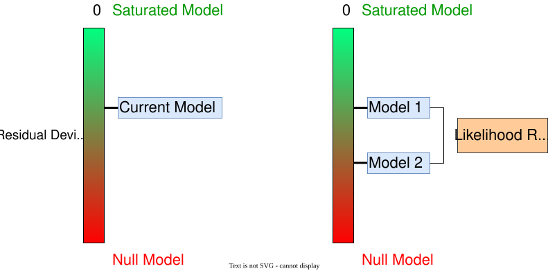



# Likelihood and Deviance {.section}

## Likelihood

The likelihood is the joint probability of the observed data viewed as a function of the parameters.

$$
\begin{aligned}
\ell(\boldsymbol{\theta} \mid \mathbf{y})
&= \log \mathcal{L}(\boldsymbol{\theta} \mid \mathbf{y}) \\
&= \log \prod_{i=1}^n f(y_i \mid \boldsymbol{\theta}) \\
&= \sum_{i=1}^n \log f(y_i \mid \boldsymbol{\theta})
\end{aligned}
$$

## Likelihood, in R

```{r}
#| collapse: true
x <- rnorm(10) # data from normal distribution

# data
x

# the model is a normal distribution with mu = 0 and sd = 1
dnorm(x, 0, 1)

# log likelihood
sum(log(dnorm(x, 0, 1)))
```

## Likelihood

By summing the logarithm all the red segments we obtain the log likelihood of the model given the observed data.

```{r}
#| echo: false
#| fig-width: 10
dat <- data.frame(x)

ll1 <- sum(log(dnorm(x, 0, 1)))

lik1 <- ggplot(dat, aes(x = x, y = 0)) +
    stat_function(fun = dnorm) +
    xlim(c(-6,6)) +
    geom_segment(aes(x = x, y = 0, xend = x, yend = dnorm(x)), col = "red") +
    geom_point(size = 3) +
    theme_minimal(base_size = 15) +
    theme(axis.text.x = element_blank(),
          axis.title.x = element_blank(),
          axis.ticks.x = element_blank(),
          plot.title = element_text(hjust = 0.5)) +
    ggtitle(latex2exp::TeX("$\\mu = 0$, $\\sigma = 1$")) +
    ylab("dnorm(x, 0, 1)") +
    annotate("label",
             x = 5, 
             size = 6,
             y = 0.2, parse = TRUE,
             label = latex2exp::TeX(sprintf("$\\log \\L = %.3f$", ll1), output = "character"))


ll2 <- sum(log(dnorm(x, 2, 1)))

lik2 <- ggplot(dat, aes(x = x, y = 0)) +
    stat_function(fun = dnorm, args = list(mean = 2, sd = 1)) +
    xlim(c(-6,6)) +
    geom_segment(aes(x = x, y = 0, xend = x, yend = dnorm(x, 2, 1)),
                 col = "red") +
    geom_point(size = 3) +
    theme_minimal(base_size = 15) +
    theme(axis.text.x = element_blank(),
          axis.title.x = element_blank(),
          axis.ticks.x = element_blank(),
          plot.title = element_text(hjust = 0.5)) +
    ggtitle(latex2exp::TeX("$\\mu = 2$, $\\sigma = 1$")) +
    ylab("dnorm(x, 2, 1)") +
    annotate("label",
             x = 5, 
             size = 6,
             y = 0.2, parse = TRUE,
             label = latex2exp::TeX(sprintf("$\\log \\L = %.3f$", ll2), output = "character"))


ll3 <- sum(log(dnorm(x, -3, 1)))

lik3 <- ggplot(dat, aes(x = x, y = 0)) +
    stat_function(fun = dnorm, args = list(mean = -3, sd = 1)) +
    xlim(c(-6,6)) +
    geom_segment(aes(x = x, y = 0, xend = x, yend = dnorm(x, -3, 1)), col = "red") +
    geom_point(size = 3) +
    ggtitle(latex2exp::TeX("$\\mu = -3$, $\\sigma = 1$")) +
    theme_minimal(base_size = 15) +
    theme(plot.title = element_text(hjust = 0.5)) +
    ylab("dnorm(x, -3, 1)") +
    annotate("label",
             x = 5, 
             size = 6,
             y = 0.2, parse = TRUE,
             label = latex2exp::TeX(sprintf("$\\log \\L = %.3f$", ll3), output = "character"))

lik1 / lik2 /  lik3
```

## Likelihood

In the previous slide we tried only 3 values for the mean. Let's image to calculate the log likelihood for several different means. The parameter with that is associated with highest likelihood is called the maximum likelihood estimator. In fact, the $\mu = 0$ is associated with the highest likelihood.

```{r, echo = FALSE}
mms <- seq(-10, 10, 0.01)
lls <- sapply(mms, function(i) sum(log(dnorm(x, i, 1))))

lik <- data.frame(mms, lls)

lik |> 
    ggplot(aes(x = mms, y = lls)) +
    geom_line() +
    xlab(latex2exp::TeX("$\\mu$")) +
    ylab(latex2exp::TeX("$\\log L$")) +
    geom_point(x = 0, y = max(lik$lls), size = 4, col = "red")
```

## Deviance

The (residual) deviance in the context of GLM can be considered as the distance between the current model and a perfect model (often called *saturated model*).

$$
D_{res} = -2[\log(\mathcal{L}_{current}) - (\log\mathcal{L}_{sat})]
$$

Where $\mathcal{L}$ is the likelihood of the considered model (see the previous slides). Clearly, the lower the deviance, the closer the current model to the perfect model suggesting a good fit.

## Deviance - Saturated model

```{r, echo = FALSE}
set.seed(200)

x <- runif(10)
y <- 0 + 3*x + rnorm(10)

dd <- data.frame(id = factor(1:10), y, x)

fit0 <- lm(y ~ 1, data = dd)
fits <- lm(y ~ 0 + id, data = dd)
fit <- lm(y ~ x, data = dd)

dd$yi <- fitted(fit)

null_plot <- ggplot(dd, aes(x = x, y = y)) +
    geom_point(size = 3) +
    stat_smooth(method = 'lm', se = FALSE, formula = y ~ 1) +
    geom_segment(aes(x = x, xend = x, y = coef(fit0)[1], yend = y)) +
    geom_point(size = 3) +
    ggtitle("Null model y ~ 1")

sat_plot <- ggplot(dd, aes(x = x, y = y)) +
    geom_point(size = 3) +
    stat_smooth(method = 'loess', span = 0.3) +
    geom_point(size = 3) +
    ggtitle("Saturated model y ~ id")

fit_plot <- ggplot(dd, aes(x = x, y = y)) +
    geom_point(size = 3) +
    stat_smooth(method = 'lm', se = FALSE) +
    geom_point(size = 3) +
    ggtitle("Current model y ~ x") +
    geom_segment(aes(x = x, xend = x, y = yi, yend = y))
```

The saturated model is a model where each observation $x_i$ has a parameter.

```{r, echo = FALSE}
sat_plot + fit_plot
```

## Deviance - Null model

Another important quantity is the *null deviance* that is expressed as the distance between the *null model* and the *saturated model*.

$$
D_{null} = -2[\log(\mathcal{L}_{null}) - (\log\mathcal{L}_{sat})]
$$

The *null deviance* can be interpreted as the maximal deviance because is estimated using a model without predictors. A good model will have a residual deviance lower than the null model.

## Deviance - Null model

```{r, echo = FALSE}
sat_plot + null_plot
```

# Inference {.section}

## Wald tests

The basic approach when doing inference with GLM is interpreting the Wald test of each model coefficient. The Wald test is calculated as follows:

$$
z = \frac{\beta_{p'} - \beta_0}{\sigma_{\beta_{p'}}}
$$

Where $\beta_{p'}$ is the regression coefficients, $\beta^0$ is the value under the null hypothesis (generally 0) and $\sigma_{\beta_{p'}}$ is the standard error. P-values and confidence intervals can be calculated based on a standard normal distribution.

## Wald-type confidence intervals

Wald-type confidence interval (directly from model summary), where $\Phi$ is the cumulative Gaussian function `qnorm()`:

$$
95\%CI = \hat \beta \pm \Phi(\alpha/2) SE_{\beta}  
$$

## Wald tests and confidence intervals

```{r}
data("teddy")

fit_teddy <- glm(Depression_pp01 ~ Parental_stress, data = teddy, family = binomial(link = "logit"))
(cc <- coef(summary(fit_teddy)))
# intercept
cc[1, 1] + qnorm(c(0.025, 0.975)) * cc[1, 2]
# slope
cc[2, 1] + qnorm(c(0.025, 0.975)) * cc[2, 2]

# directly
confint.default(fit_teddy)
```

## Profile likelihood confidence intervals

The computation is a little bit different and they are not always symmetric:

```{r}
# profile likelihood, different from wald type
confint(fit_teddy)
```

## Confidence intervals

When calculating confidence intervals it is important to consider the link function. In the same way as we compute the inverse logit function on the parameter value, we could revert also the confidence intervals. **IMPORTANT, do not apply the inverse logit on the standard error and then compute the confidence interval**.

```{r}
# nice way to extract model coefficients
fits <- broom::tidy(fit_teddy)

b <- fits$estimate[2] # slope
se <- fits$std.error[2] # standard error

# correct, wald-type confidence intervals
c(b = exp(b), lower = exp(b - 2*se), upper = exp(b + 2*se))

# wrong wald type
c(b = exp(b), lower = exp(b) - 2*exp(se), upper = exp(b) + 2*exp(se))
```

## Confidence intervals^[Notice that I use `2*se` instead of the precise quantile of the Gaussian distribution that for $\alpha = 0.05$ is $\sim 1.96$]

```{r}
b <- fits$estimate[2]
se <- fits$std.error[2]

# correct, wald-type confidence intervals
c(b = exp(b), lower = exp(b - 2*se), upper = exp(b + 2*se))

# wrong wald type
c(b = exp(b), lower = exp(b) - 2*exp(se), upper = exp(b) + 2*exp(se))
```

## Confidence intervals

The same principle holds for predicted probabilities. First compute the intervals on the logit scale and then transform-back on the probability scale:

```{r}
dd <- data.frame(Parental_stress = 50:60)
pp <- data.frame(predict(fit_teddy, data.frame(Parental_stress = 50:60), se.fit = TRUE))
pp <- cbind(dd, pp)

pp$lower_ci <- plogis(pp$fit - 2*pp$se.fit)
pp$upper_ci <- plogis(pp$fit + 2*pp$se.fit)

pp
```

## Anova

With multiple predictors, especially with categorical variables with more than 2 levels, we can compute the an anova-like analysis individuating the effect of each predictor. In R we can do this using the `car::Anova()` function. Let's add more predictors with the `teddy` dataset. This is the maximal models with all predictors and interactions.

```{r, echo = FALSE}
fit_anova <- glm(Depression_pp01 ~ Education + Parental_stress + Education:Parental_stress, family = binomial(link = "logit"), data = teddy)
summary(fit_anova)
```

## Anova

```{r}
plot(allEffects(fit_anova))
```

## Anova

Then using `car::Anova()`. For each effect we have the $\chi^2$ statistics and the associated p-value. The null hypothesis is that the specific factor did not contribute in reducing the residual deviance.

```{r}
car::Anova(fit_anova)
```

## Deviance - Likelihood Ratio Test

When we perform a likelihood ratio test (see previous slides) we are essentially comparing the residual deviance (or the likelihood) of two models.

```{r, echo = FALSE}
dat <- sim_design(50, covariates = list(x = new_cov(runif)))
dat <- sim_data(dat, ~x, c(qlogis(0.01), 8), family = binomial(), which.mu = "prob", rng.arg = list(size = 1))
```

```{r}
fit_null <- glm(y ~ 1, data = dat, family = binomial(link = "logit"))
fit_current <- glm(y ~ x, data = dat, family = binomial(link = "logit"))
```

## Deviance - Likelihood Ratio Test

With the null model clearly the residual deviance is the same as the null deviance because we are not using predictors to reduce the deviance.

```{r}
summary(fit_null)
```

## Deviance - Likelihood Ratio Test

If the predictor `x` is useful in explaining `y` the residual deviance will be reduced compared to the null (overall deviance).

```{r}
summary(fit_current)
```

## Deviance - Likelihood Ratio Test

Comparing the two models we can understand if the deviance reduction can be considered statistically significant.

```{r}
anova(fit_null, fit_current, test = "LRT")
```

Notice that the difference between the two residual deviances is the test statistics that is distributed as a $\chi^2$ with $df = 1$.

## Deviance - Likelihood Ratio Test

```{r, echo = FALSE}

```

## Deviance^[Adapted from https://bookdown.org/egarpor/SSS2-UC3M/logreg-deviance.html]

```{r, echo = FALSE}
d <- data.frame(
    x = seq(0, 1, 0.01)
)

d$y <- plogis(qlogis(0.2) + d$x*5)
d$p <- rbinom(nrow(d), 1, d$y)

d |>
    slice_sample(n = 30) |> 
    ggplot() +
    ylim(c(0, 1)) +
    geom_line(aes(x = x, y = y, color = "Current Model"),
              linewidth = 0.8) +
    geom_hline(aes(yintercept = mean(d$p), color = "Null Model"),
               linewidth = 0.8) +
    geom_line(aes(x = x, y = p, color = "Saturated Model"),
              linewidth = 0.8) +
    geom_point(aes(x = x, y = p), size = 3) +
    scale_color_manual(values = c("#3CBCF8", "black", "#1CA14E")) +
    theme(legend.title = element_blank(),
          legend.position = c(0.85,0.2)) +
    ylab("Probability")
```

## Deviance - Example 

```{r, echo = FALSE}
n <- 100
n_watching <- n/2 # just for simplicity
p_pass_yes <- 0.7
p_pass_no <- 0.3

dat <- data.frame(
    tv_shows = rep(c(1, 0), each = n_watching)
)

b0 <- 0.3 # P(passing|not watching)
b1 <- 3.5 # odds ratio between watching and not watching

# pn_from_or(0.3, 3.5) # P(passing|watching)

dat$exam <- rbinom(n, 1, plogis(qlogis(b0) + log(b1)*dat$tv_shows))
fit <- glm(exam ~ tv_shows, data = dat, family = binomial(link = "logit"))
dat$id <- factor(1:nrow(dat))
```

Let's fit the three models:

```{r}
# null
fit0 <- glm(exam ~ 1, data = dat, family = binomial(link = "logit"))
# current
fit <- glm(exam ~ tv_shows, data = dat, family = binomial(link = "logit"))
# saturated
fits <- glm(exam ~ 0 + id, data = dat, family = binomial(link = "logit"))
```

## Deviance - Example 

We can calculate the residual deviance:

```{r}
-2*(logLik(fit) - logLik(fits))
deviance(fit)
```

We can calculate the null deviance:

```{r}
-2*(logLik(fit0) - logLik(fits))
deviance(fit0)
```

## Model comparison

The table obtained with `car::Anova()` is essentially a model comparison using the Likelihood Ratio Test. This can be done using the `anova(...)` function.

$$
\begin{align*}
D = 2 (log(\mathcal{L}_{full}) - log(\mathcal{L}_{reduced})) \\
D \sim \chi^2_{df_{full} - df_{reduced}}
\end{align*}
$$

## Model comparison

To better understanding, the `Education` effect reported in the `car::Anova()` table is a model comparison between a model with `y ~ Education + Parental_stress` and a model without `Education`. The difference between these two model is the unique contribution of `Education` after controlling for `Parental_stress`:

```{r}
fit <- glm(Depression_pp01 ~ Education + Parental_stress, family = binomial(link = "logit"), data = teddy)
fit0 <- glm(Depression_pp01 ~ Education, data = teddy, family = binomial(link = "logit"))

anova(fit0, fit, test = "LRT") # ~ same as car::Anova(fit_max)
car::Anova(fit)
```

## Model comparison

The model comparison using `anova()` (i.e., likelihood ratio tests) is limited to nested models thus models that differs only for one term. For example:

```{r}
fit1 <- glm(Depression_pp01 ~ Education, family = binomial(link = "logit"), data = teddy)
fit2 <- glm(Depression_pp01 ~ Parental_stress, family = binomial(link = "logit"), data = teddy)
fit3 <- glm(Depression_pp01 ~ Education + Parental_stress, family = binomial(link = "logit"), data = teddy)
```

`fit1` and `fit2` are non-nested because we have the same number of predictors (thus degrees of freedom). `fit3` and `fit1`/`fit2` are nested because `fit3` is more complex and removing one term we can obtain the less complex models.

## Model comparison

```{r}
anova(fit1, fit2, test = "LRT") # do not works properly
anova(fit1, fit3, test = "LRT") # same anova(fit2, fit3)
```

## Information Criteria

As for standard linear models I can use the Akaike Information Criteria (AIC) or the Bayesian Information Criteria (BIC) to compare non-nested models. The downside is not having a properly hypothesis testing setup.

```{r}
data.frame(BIC(fit1, fit2, fit3)) |> 
    arrange(BIC)

data.frame(AIC(fit1, fit2, fit3)) |> 
    arrange(AIC)
```

# Plotting effects {.section}

## R packages

Everything can be simplified using some packages to perform each step and returning a plot:

- `allEffects()` from the `effects()` package (return a base R plot)
- `ggeffect()` from the `ggeffect()` package (return a `ggplot2` object)
- `plot_model` from the `sjPlot` package (similar to `ggeffect()`)

## Quick plots with `allEffects()`

`effects::allEffects()` provides quick but not very beautiful plots. They are also not very easy to customize, especially if you are familiar with `ggplot2`:

```{r}
plot(allEffects(fit_anova))
```

## Quick plots with `ggeffect()`

`ggeffect::ggeffect()` provides the same quick functionalities of `effects` (in fact uses `effects`) but it returns a `ggplot2` object.

```{r}
cowplot::plot_grid(plotlist = plot(ggeffects::ggeffect(fit_anova)))
```

## Coefficients plots with `sjplot::plot_model()`

```{r}
sjPlot::plot_model(fit_anova)
```
